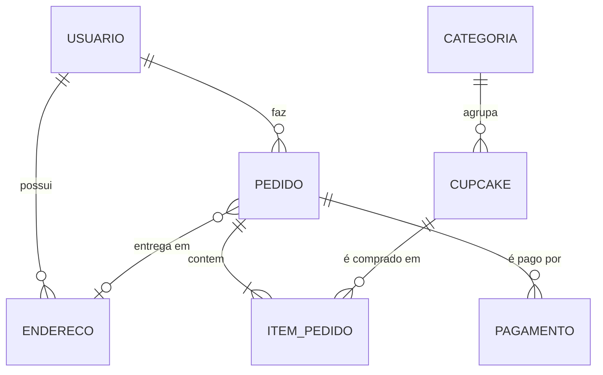

# Banco de dados

SGBD: PostgreSQL 14+ (SQLite em desenvolvimento e testes). Script completo em `database/schema.sql`.

## Modelo entidade-relacionamento

## Decisões de modelagem

- Modelo normalizado até a 3FN.
- `item_pedido.preco_unitario` e `pedido.subtotal/total` são redundâncias intencionais, para preservar o histórico financeiro quando o preço de um cupcake muda.
- Endereço é opcional no pedido (retirada na loja).
- Um pedido pode ter várias tentativas de pagamento; as recusadas ficam registradas.
- Valores monetários em `NUMERIC(10,2)`; datas em UTC.
- Integridade: FKs; `UNIQUE` em `usuario.email`, `categoria.nome` e `pagamento.transacao_id`; `CHECK` em preço, quantidade, total, tipo de entrega, método e status de pagamento.
- Índices nas FKs mais consultadas e em `usuario.email`.
- Só o hash da senha e os 4 últimos dígitos do cartão são armazenados.

## Dicionário de dados

### categoria

| Coluna | Tipo | Nulo | Chave / restrição | Descrição |
|---|---|---|---|---|
| id | SERIAL | Não | PK | Identificador |
| nome | VARCHAR(60) | Não | UNIQUE | Nome da categoria |

### usuario

| Coluna | Tipo | Nulo | Chave / restrição | Descrição |
|---|---|---|---|---|
| id | SERIAL | Não | PK | Identificador |
| nome | VARCHAR(120) | Não | | Nome completo |
| email | VARCHAR(160) | Não | UNIQUE | Login (minúsculas) |
| telefone | VARCHAR(20) | Não | | Telefone com DDD, só dígitos |
| senha_hash | VARCHAR(255) | Não | | Hash da senha |
| is_admin | BOOLEAN | Não | | TRUE para funcionários |
| criado_em | TIMESTAMP | Não | | Data do cadastro (UTC) |

### cupcake

| Coluna | Tipo | Nulo | Chave / restrição | Descrição |
|---|---|---|---|---|
| id | SERIAL | Não | PK | Identificador |
| categoria_id | INTEGER | Não | FK → categoria.id, índice | Categoria |
| nome | VARCHAR(100) | Não | | Nome na vitrine |
| descricao | VARCHAR(400) | Não | | Descrição / ingredientes |
| preco | NUMERIC(10,2) | Não | CHECK (preco > 0) | Preço unitário |
| emoji | VARCHAR(8) | Não | | Ilustração |
| disponivel | BOOLEAN | Não | | FALSE oculta da vitrine sem apagar o histórico |

### endereco

| Coluna | Tipo | Nulo | Chave / restrição | Descrição |
|---|---|---|---|---|
| id | SERIAL | Não | PK | Identificador |
| usuario_id | INTEGER | Não | FK → usuario.id, índice | Dono |
| cep | VARCHAR(9) | Não | | Formato 00000-000 |
| logradouro | VARCHAR(160) | Não | | Rua/avenida |
| numero | VARCHAR(10) | Não | | Número |
| complemento | VARCHAR(80) | Sim | | Apto, bloco etc. |
| bairro | VARCHAR(80) | Não | | Bairro |
| cidade | VARCHAR(80) | Não | | Cidade |
| uf | VARCHAR(2) | Não | | Sigla do estado |

### pedido

| Coluna | Tipo | Nulo | Chave / restrição | Descrição |
|---|---|---|---|---|
| id | SERIAL | Não | PK | Número do pedido |
| usuario_id | INTEGER | Não | FK → usuario.id, índice | Cliente |
| endereco_id | INTEGER | Sim | FK → endereco.id | Endereço de entrega (NULL em retirada) |
| tipo_entrega | VARCHAR(10) | Não | CHECK IN ('ENTREGA','RETIRADA') | Tipo de entrega |
| status | VARCHAR(25) | Não | | AGUARDANDO_PAGAMENTO, PAGO, EM_PREPARO, SAIU_PARA_ENTREGA, PRONTO_PARA_RETIRADA, ENTREGUE ou CANCELADO |
| subtotal | NUMERIC(10,2) | Não | | Soma dos itens |
| taxa_entrega | NUMERIC(10,2) | Não | | Frete cobrado |
| total | NUMERIC(10,2) | Não | CHECK (total >= 0) | subtotal + taxa_entrega |
| observacoes | VARCHAR(300) | Sim | | Recado do cliente |
| criado_em | TIMESTAMP | Não | | Data do pedido (UTC) |

### item_pedido

| Coluna | Tipo | Nulo | Chave / restrição | Descrição |
|---|---|---|---|---|
| id | SERIAL | Não | PK | Identificador |
| pedido_id | INTEGER | Não | FK → pedido.id, índice | Pedido |
| cupcake_id | INTEGER | Não | FK → cupcake.id | Cupcake comprado |
| quantidade | INTEGER | Não | CHECK (quantidade > 0) | Unidades (máx. 50) |
| preco_unitario | NUMERIC(10,2) | Não | | Preço no momento da compra |

### pagamento

| Coluna | Tipo | Nulo | Chave / restrição | Descrição |
|---|---|---|---|---|
| id | SERIAL | Não | PK | Identificador |
| pedido_id | INTEGER | Não | FK → pedido.id, índice | Pedido |
| metodo | VARCHAR(10) | Não | CHECK IN ('PIX','CARTAO') | Forma de pagamento |
| status | VARCHAR(12) | Não | CHECK IN ('APROVADO','RECUSADO') | Resultado |
| valor | NUMERIC(10,2) | Não | | Valor cobrado |
| transacao_id | VARCHAR(40) | Não | UNIQUE | Código da transação (simulado) |
| cartao_final | VARCHAR(4) | Sim | | 4 últimos dígitos (só cartão) |
| criado_em | TIMESTAMP | Não | | Data da tentativa (UTC) |
