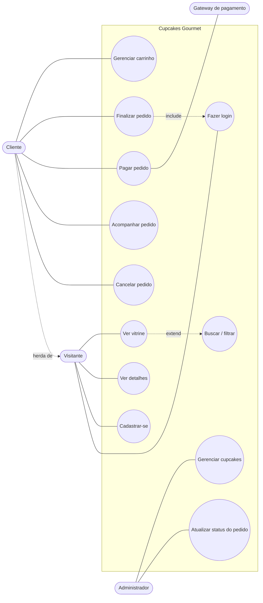
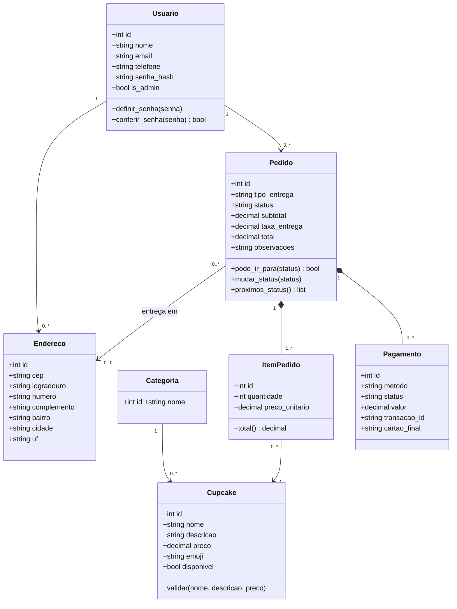
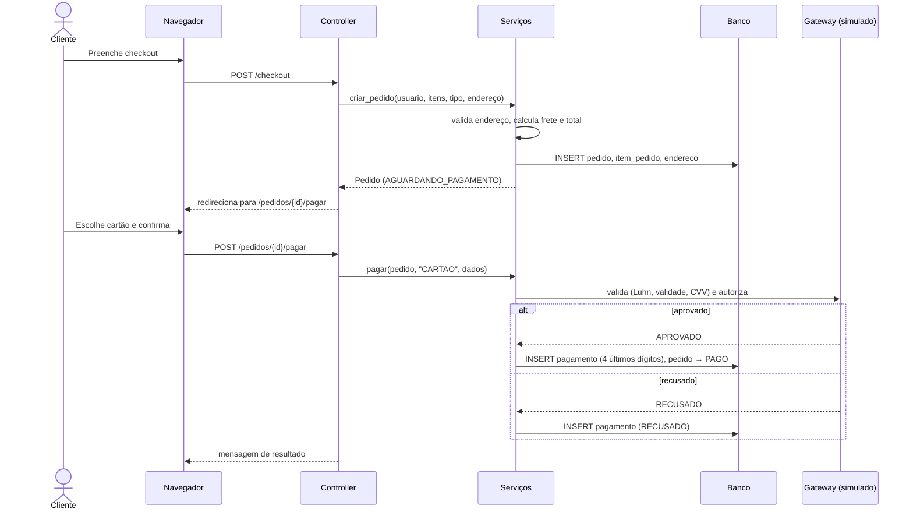
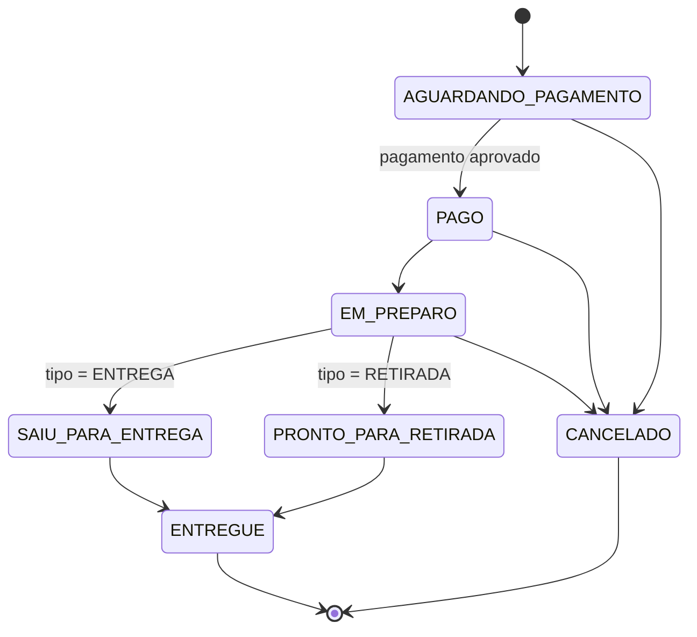

# Modelagem UML

Diagramas em Mermaid (renderizados automaticamente pelo GitHub).

## Casos de uso

## Diagrama de classes

`ItemPedido.preco_unitario` guarda o preço no momento da compra, então alterar o preço do cupcake não afeta pedidos antigos. Um pedido pode ter vários `Pagamento` porque as tentativas recusadas também são registradas.

## Sequência: compra com pagamento

## Estados do pedido

Implementado em `app/models/pedido.py` (`TRANSICOES`).
